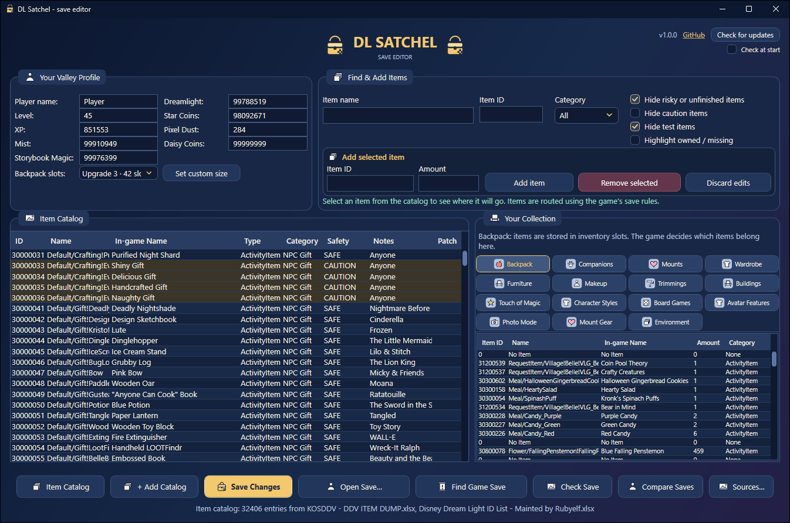
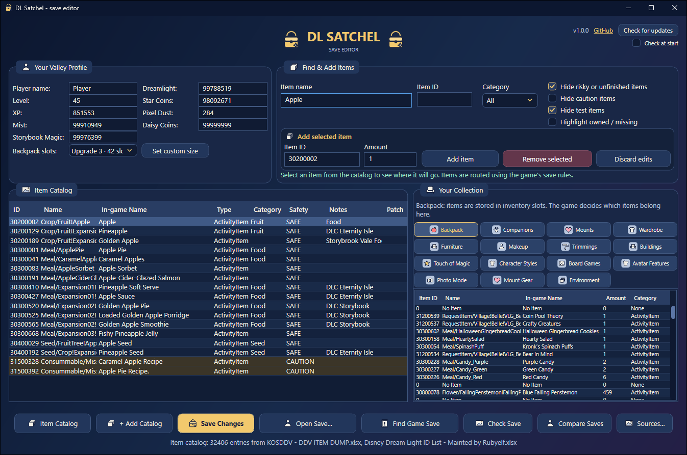
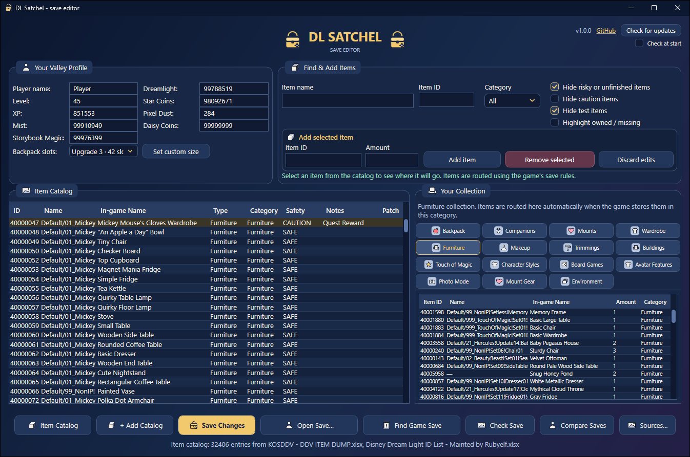

<h1 align="center">DL Satchel</h1>

<p align="center">
<b>A simple save editor.</b><br>
Add items, clothes, furniture, companions and coins to your save on PC.<br>
<a href="README.pl.md">Polska wersja</a>
</p>



Your whole game is kept in one file on your PC. This program opens it as simple lists: you pick
what to add or remove, click **Save Changes**, start the game - done. It makes a backup every
time, so you can always go back.

The game keeps the save **encrypted**. The editor decrypts it by itself and encrypts it again when
saving, so you don't need any other tools.

> Fan-made and unofficial. PC version only. Changing a save is at your own risk.

## You need two things

1. **The editor** - download `DLSatchel.exe` from
   [Releases](https://github.com/Dysprohol/DLSatchel/releases). One file, nothing to install.
2. **Item lists (Excel files)** - the editor does **not** work without them. They are made by
   players on the FearLess Revolution forum:
   - **KOSDDV item dump** - open [this Google Sheet](https://docs.google.com/spreadsheets/d/1uxiBlhMhTtuo7xMd5gGsj7H7GyowfOlJqfA-R_i5jjM/edit)
     and click **File > Download > Microsoft Excel (.xlsx)**.
   - **Rubyelf's ID list** - open [this Google Sheet](https://docs.google.com/spreadsheets/d/1bBrfqq6m9qqZDXFVtqf646xD5LvLM2W1q1YTH0YVoZo/edit)
     and click **File > Download > Microsoft Excel (.xlsx)**.

   Use both if you can. New items and questions:
   [the forum thread](https://fearlessrevolution.com/viewtopic.php?f=2&t=21330),
   where the people who make the lists post.

## How to use it

1. **Close the game.**
2. Start the editor (if Windows warns you: **More info > Run anyway**).
3. Click **Item Catalog** and pick an Excel file; add the second one with **+ Add Catalog**.
   You only do this once.
4. Click **Find Game Save** and choose your save.
5. Find an item: type its name in **Item name**, click it in the list, set **Amount**,
   click **Add item** or just double click on it. It goes to the right place by itself (backpack, wardrobe, furniture...).
   Umbrellas, parasols and other things you hold are not clothes: find them on the
   **Tools & Accessories** tab.

   

6. To remove something, open a collection on the right, select it and click **Remove selected**.
   Coins and level are edited at the top left.
7. Click **Save Changes**, confirm, and start the game.



## Updates

Top right in the editor: **GitHub** opens this page, **Check for updates** asks GitHub for a newer
version. If there is one, click **Update now** - the editor downloads it, checks it and restarts.
Tick **Check at start** to check every time; otherwise the editor never goes online by itself.

## Safety labels

| | |
|---|---|
| | **SAFE** | A normal item. |
| | **CAUTION** (brown row) | Quest, event or shop item. Added too early, it can get a quest stuck. |
| | **UNSAFE** | Broken or test item that can damage a save. Hidden unless you turn it on. |
| | **UNKNOWN** | The lists say too little about it. |

## Going back

Next to your save the editor keeps `profile.json.bak` (from before your first change) and
`profile.json.backup-<date>` (before every save). Close the game, rename the copy you want to
`profile.json`, and it is back. The save folder:
`%USERPROFILE%\AppData\LocalLow\Gameloft\Disney Dreamlight Valley` (paste it into File Explorer).

## Support

Did it save you some grinding? [Buy me a coffee on Ko-fi](https://ko-fi.com/Dysprohol).

<details>
<summary>For developers</summary>

.NET 10 WPF. `src/DLSatchel` is the app, `tests/DLSatchel.Tests` the tests.

```
dotnet build DLSatchel.sln
dotnet test tests/DLSatchel.Tests
```

Publish `src/DLSatchel` with the `FolderProfile` profile to get the single `.exe` in
`output\`. Some tests need both Excel files in a `pliki_testowe` folder next to the solution.

</details>
