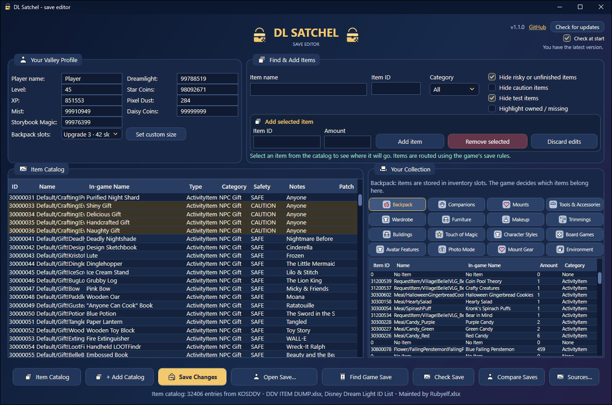
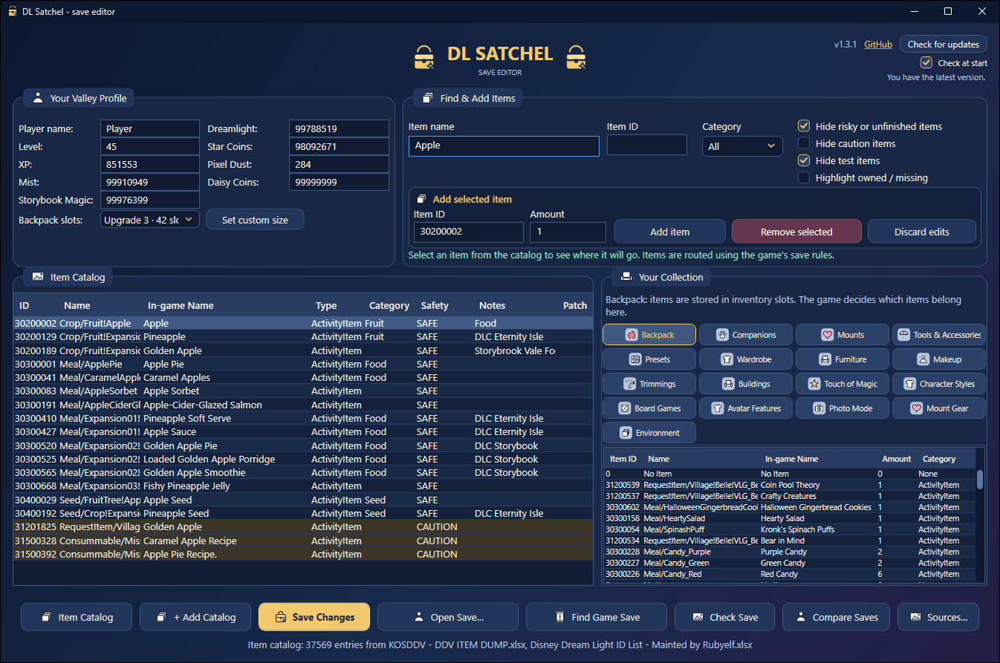
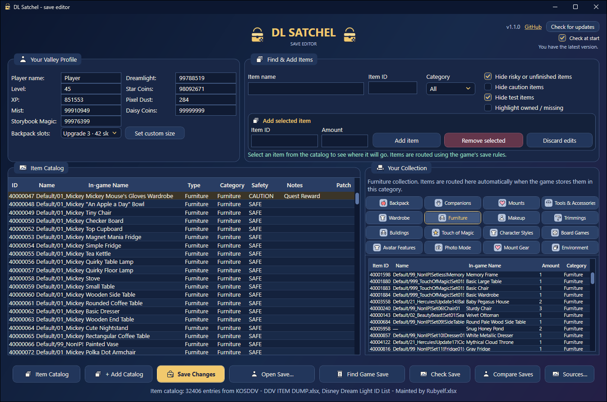
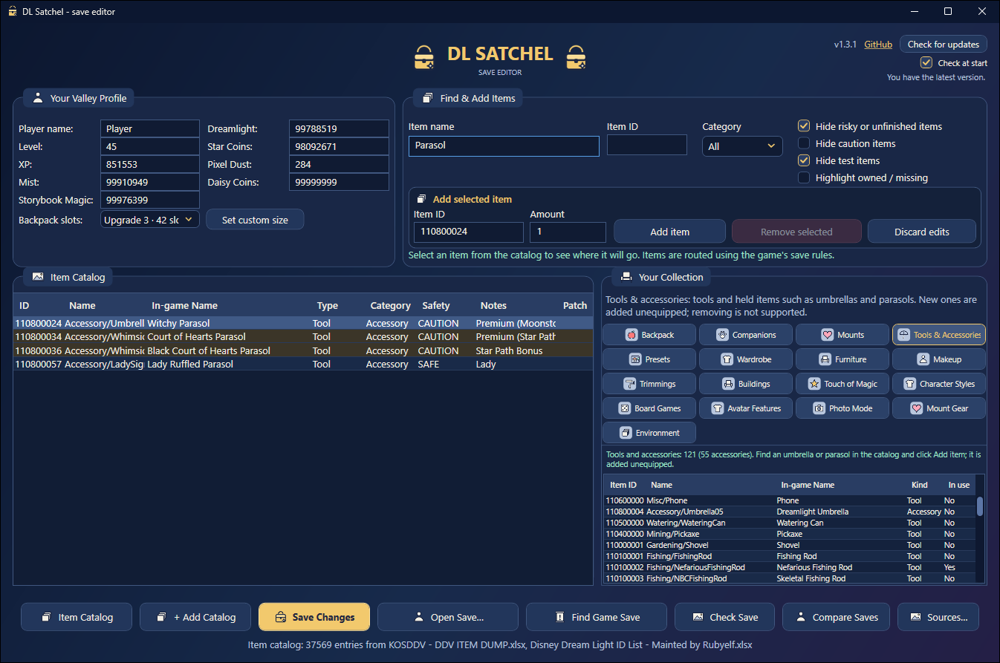
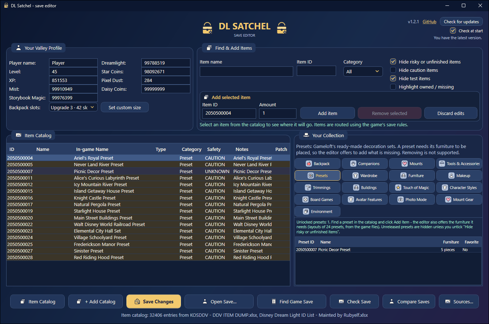

<h1 align="center">DL Satchel</h1>

<p align="center">
<b>Prosty edytor zapisu.</b><br>
Dodawaj przedmioty, ubrania, meble, towarzyszy i monety do swojego zapisu na PC.<br>
<a href="README.md">English version</a>
</p>



Cała Twoja gra siedzi w jednym pliku na komputerze. DL Satchel otwiera ten plik i pokazuje go jako
zwykłe listy. Wybierasz, co chcesz, klikasz **Save Changes**, uruchamiasz grę - i to już tam jest.

Nie musisz znać się na plikach. Gra szyfruje zapis, a edytor sam sobie z tym radzi. Przed każdym
zapisem robi kopię zapasową, więc zawsze możesz wrócić.

> Nieoficjalne, zrobione przez fana. Tylko wersja na PC. Zmiana zapisu na własne ryzyko.

## Czego potrzebujesz

1. **DL Satchel** - pobierz `DLSatchel.exe` z
   [Releases](https://github.com/Dysprohol/DLSatchel/releases). To jeden plik, nic się nie instaluje.
2. **Dwóch list przedmiotów (pliki Excel)** - **bez nich edytor nie działa**. Prowadzą je gracze
   z forum FearLess Revolution. Otwórz każdy link i kliknij
   **Plik > Pobierz > Microsoft Excel (.xlsx)**:
   - [dump przedmiotów KOSDDV](https://docs.google.com/spreadsheets/d/1uxiBlhMhTtuo7xMd5gGsj7H7GyowfOlJqfA-R_i5jjM/edit)
   - [lista ID od Rubyelf](https://docs.google.com/spreadsheets/d/1bBrfqq6m9qqZDXFVtqf646xD5LvLM2W1q1YTH0YVoZo/edit)

   Nowe przedmioty i pytania: [wątek na forum](https://fearlessrevolution.com/viewtopic.php?f=2&t=21330),
   gdzie piszą autorzy list.

## Jak używać

1. **Zamknij grę.**
2. Uruchom `DLSatchel.exe`. Jeśli Windows ostrzega, kliknij **Więcej informacji > Uruchom mimo to**.
3. Kliknij **Item Catalog** i wybierz pierwszy plik Excel, a potem **+ Add Catalog** dla drugiego.
   Robisz to tylko raz - edytor je zapamiętuje.
4. Kliknij **Find Game Save** i wybierz swój zapis.
5. Wpisz nazwę w **Item name**, kliknij przedmiot na liście, ustaw **Amount** i kliknij **Add item**
   (albo po prostu kliknij przedmiot dwa razy). Edytor sam włoży go we właściwe miejsce.

   

6. Żeby coś usunąć, otwórz kolekcję po prawej (np. **Furniture**), zaznacz przedmiot i kliknij
   **Remove selected**. Monety i poziom są na górze po lewej.

   

7. Kliknij **Save Changes**. Edytor pokaże, co się zmieni (np. „Backpack”), i poprosi
   o potwierdzenie. Potem uruchom grę.

## Parasolki i parasole

Rzeczy, które postać trzyma w ręce - parasolki, parasole i podobne - to **nie ubrania**. Gra trzyma je
razem z narzędziami. Otwórz zakładkę **Tools & Accessories**, znajdź przedmiot i kliknij
**Add item**. Zostanie dodany jako nieużywany, więc wybierzesz go w grze.



## Presety dekoracji

Gotowe zestawy dekoracji od Gameloftu (np. „Knight Castle Preset” albo „Haunted Mansion Wall
Preset”) są w zakładce **Presets**. Wybierz jeden i kliknij **Add item** - po zapisaniu pojawi się
w grze w menu presetów.

Preset da się postawić tylko wtedy, gdy masz jego meble. Przy dodawaniu edytor pokaże, których
brakuje, i może je od razu dodać do Twojego magazynu mebli.

Większość presetów pochodzi ze sklepu. Te, które listy opisują jako „unreleased”, są na początku
ukryte: odznacz **Hide risky or unfinished items**, żeby je zobaczyć.



## Co znaczą oznaczenia

Każdy przedmiot na liście ma oznaczenie w kolumnie **Safety**:

| Oznaczenie | Co znaczy |
|---|---|
| **SAFE** | Zwykły przedmiot. |
| **CAUTION** (brązowy wiersz) | Z questa, eventu albo sklepu. Dodany za wcześnie może zablokować quest. |
| **UNSAFE** | Zepsuty albo testowy, może uszkodzić zapis. Ukryty, dopóki go nie włączysz. |
| **UNKNOWN** | Listy mówią o nim za mało. |

## Aktualizacje

W prawym górnym rogu edytora kliknij **Check for updates**. Jeśli jest nowsza wersja, kliknij
**Update now** - edytor ją pobierze, sprawdzi i uruchomi się ponownie. Zaznacz **Check at start**,
żeby sprawdzał przy każdym uruchomieniu; inaczej sam z siebie nie łączy się z internetem.

## Powrót do poprzedniego stanu

Obok zapisu edytor trzyma dwa rodzaje kopii:

- `profile.json.bak` - zapis sprzed pierwszej zmiany,
- `profile.json.backup-<data>` - kopia sprzed każdego zapisu.

Żeby wrócić: zamknij grę i zmień nazwę wybranej kopii na `profile.json`. Folder zapisu to
`%USERPROFILE%\AppData\LocalLow\Gameloft\Disney Dreamlight Valley` (wklej w Eksplorator plików).

## Wsparcie

Oszczędził Ci trochę grindu? [Postaw mi kawę na Ko-fi](https://ko-fi.com/Dysprohol).

<details>
<summary>Dla programistów</summary>

.NET 10 WPF. `src/DLSatchel` to aplikacja, `tests/DLSatchel.Tests` to testy.

```
dotnet build DLSatchel.sln
dotnet test tests/DLSatchel.Tests
```

Opublikuj `src/DLSatchel` profilem `FolderProfile`, a jednoplikowy `.exe` trafi do `output\`.
Część testów potrzebuje obu plików Excel w folderze `pliki_testowe` obok solucji.

</details>
